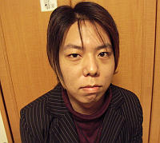
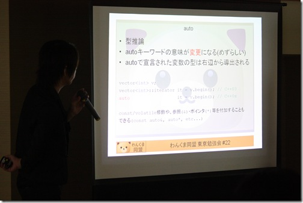
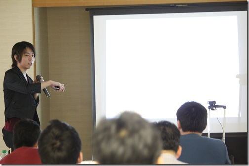
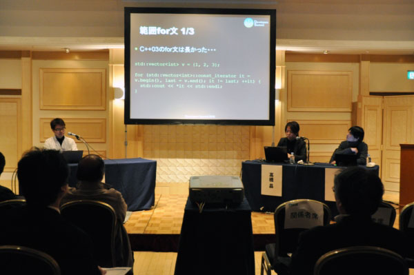
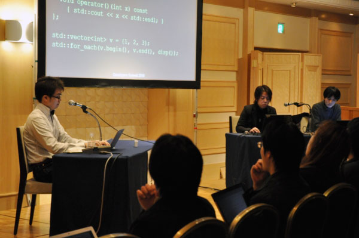
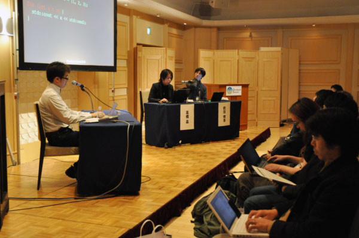
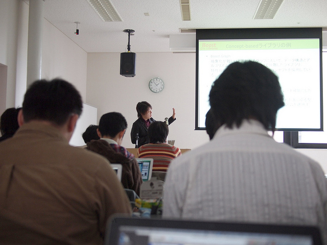
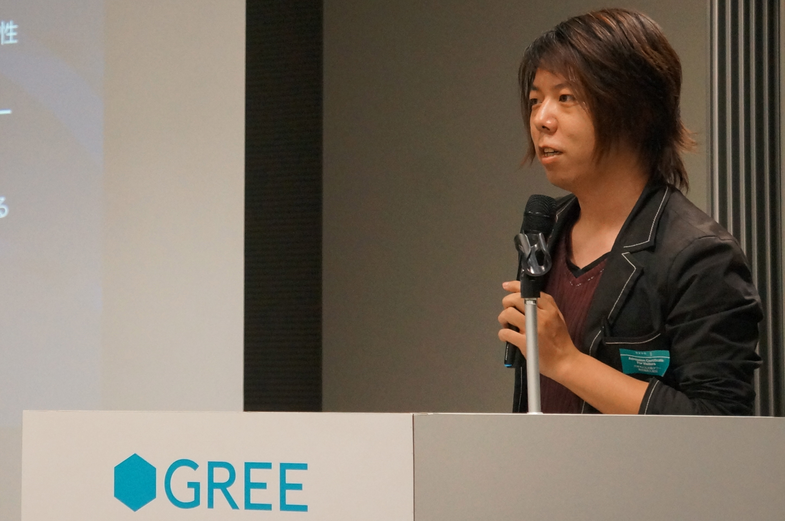

# Akira Takahashi

[Japanese version (日本語バージョン)](./index.html)

This is Akira Takahashi's personal site.
It includes his profile, public presentations, published books, technical articles, etc.
For work inquiries, please use one of the mail addresses in [Contact](#contact).

Akira Takahashi
Born March 1, 1985 Miyagi-ken. Japan

## Affiliations
- [Preferred Networks, Inc.](https://www.preferred-networks.jp/) engineer
- [boostjp community](http://boostjp.github.io/) core member
- [cpprefjp community](http://cpprefjp.github.io/) core member
- [P-Stade C++ Libraries](http://p-stade.sourceforge.net/) manager
- [Boost Geometry Library](http://www.boost.org/libs/geometry/doc/html/index.html) contributor
- [Boost.StudyMeeting](http://boostjp.github.io/study_meeting.html) organizer
- [C++ MIX](https://cppmix.connpass.com/) organizer

## Blogs
- [Faith and Brave - C++で遊ぼう](http://faithandbrave.hateblo.jp/)
- [あきらきらライフ](https://note.com/akirakiralife)

## GitHub Repository
- <https://github.com/faithandbrave>

## Contact
- Personal mail address : faithandbrave@gmail.com
- My Company mail address : akirat@preferred.jp
- X : [@cpp_akira](https://x.com/cpp_akira)

## Programming Languages
C++, Python, TypeScript, JavaScript, Elixir, Ruby, C#, Objective-C++, PHP.

## Work Experience

- 2005-2007 Delivery management system for a transportation company
    - Client program for Windows CE devices (C++), and server program on Windows Server (C++)
    - The Windows CE compiler was even more limited than Visual C++ 6.0, so the language was a subset of C++98. I implemented the features of the Boost C++ Libraries that we needed for that environment
    - The client communicated with the server in real time over a TCP-based protocol, and the server talked to an Oracle database
- 2008-2009 iOS game development
    - Developed Square Enix's first iOS titles: "Crystal Defenders" and its sequel "Sacred Lands"
    - It was the iOS 2.1 era, and the NDA was strict enough that even exchanging information between developers was prohibited. With only the official English documentation and a little forum information available, I translated the documentation into Japanese and shared it within the team
    - Written in Objective-C++
    - Rendering with OpenGL, music playback with OpenAL
- 2010-2017
    - iPhone application about cars for children (Objective-C)
    - E-book iPhone application (C++, OpenGL)
    - GungHo Online Entertainment's "Ragnarok Odyssey ACE" (C++, PlayStation Vita)
        - Responsible for monster and projectile movement
    - Training and education for professional programmers
        - Design, development process, test-driven development, and so on
    - 3D browser game (C++, Emscripten)
        - Compiled a C++ program using OpenGL into JavaScript with Emscripten, and developed a 3D game running in the browser
    - Koei Tecmo (Gust brand) "Trinary Girls" (Kakucho Shoujo Trinary)
        - Developed a 3D game for smartphones with the Unity 3D game engine
        - Responsible for the client (C#) and the server (Python, Django)
    - Real-time strategy game for smartphones
        - Developed real-time network battles with the Photon game engine (C#) and Unity 3D
    - Server development for a smartphone quiz game
        - Developed the quiz game server in Elixir
    - Published the programming magazine "Programming no Madosho" (The Grimoire of Programming), Vol.1 to Vol.3
        - In addition to interviews with notable figures such as Bjarne Stroustrup, the creator of C++, leading experts on each programming language in Japan wrote articles for it
        - With few programming books for intermediate and advanced readers available, I was able to create a programming magazine that collected advanced topics
- 2017- Preferred Networks, Inc.
    - Participating in the development of MN-Core, an accelerator for deep learning
        - Developing the emulator, assembler, and more (C++, Python)
- 2023- Game development
    - Participating in the development of "Theory", a P2P networking game engine by TVT Inc.

## Pictures

Wankuma Study Meeting in Tokyo #22 - "C++0x - Talking about the future of the language"

Developers Summit 2010 "C++0x, Ruby, ECMAScript5 About International Standardization"

Boost.StudyMeeting #6 in Sapporo

GREE Tech Talk #05
